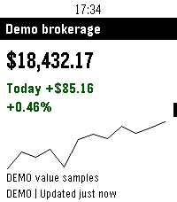
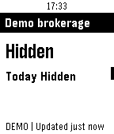

# Pebble Hood

A personal, viewing-only portfolio app for Pebble Time 2 and Pebble 2 Duo. Native C screens, PebbleKit JS phone bridge, private Python backend, browser-based Robinhood OAuth utility, encrypted storage, account selection, and a deterministic demo.

**The demo is working and compiled. Live Robinhood display is not yet verified.** Official OAuth discovery and public-client registration were tested successfully. Login, actual account coverage, token refresh, tool schemas and field mapping still need your account-assisted verification. No passwords, unofficial APIs, scraping or trading operations are used.

 

## Try it

Download [pebble-hood-demo.pbw](dist/pebble-hood-demo.pbw), AirDrop/open it on your iPhone in the Pebble app, then launch **Hood Demo**. Select opens Holdings, Refresh, Next account, Hide/show and Info/connect. Up/Down moves through overview/status cards, native menus or scrollable details; Back returns.

Every demo value is labeled. It includes fractional holdings, ETFs, missing cost/price data, an unsupported option included in the full total, two holding pages and an empty account. Stock daily price movement and position investment return are separately labeled.

## Build and connect

For browser-only demo installation, [import directly into CloudPebble](https://cloudpebble.repebble.com/ide/import/github/kvnsr1/pebble-hood), then follow the [CloudPebble / Dev Connection steps](docs/setup.md#current-cloudpebble-browser-build-and-dev-connection).

```sh
./scripts/setup.sh
./scripts/test.sh
./scripts/build.sh --demo
./scripts/pebble.sh install --emulator emery --vnc dist/pebble-hood-demo.pbw
```

For a configured build, run the backend behind your HTTPS origin, set `HOOD_BACKEND_URL`, build with `./scripts/build.sh --live`, and pair from the phone settings using `python -m backend.manage pair`. Demo data also works through the authenticated backend. Robinhood connection starts with `python -m backend.manage connect`; live display stays gated until its actual schemas and response mapping are reviewed.

- [Exact iPhone, backend, HTTPS, SDK and CloudPebble instructions](docs/setup.md)
- [Verified Robinhood findings and login/mapping steps](docs/robinhood-access.md)
- [Architecture, financial semantics and message contract](docs/contract.md)
- [Reviewed Pebble resources, design decisions and licenses](docs/design-references.md)
- [Build/test results and emulator screenshots](docs/verification.md)

Only `flint` (144×168 monochrome) and `emery` (200×228 color) are declared. No physical-watch/iPhone verification or production deployment is claimed. The current CloudPebble workflow was researched; the local SDK build is the verified path.
