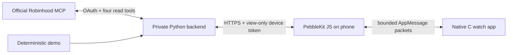

# Data contract v1 and reliability

No ordinary retrieval/calculation requires an LLM. OAuth tokens never enter phone/watch messages. The standalone demo bundles the same fixture directly; the configured build's demo source uses the authenticated backend.

`GET /v1/accounts?source=demo|robinhood` returns `{provider, accounts:[{id,name}]}`. `GET /v1/portfolio?source=...&account=...&page=0` returns the normalized page described below. All `/v1` reads require an Authorization bearer token. `POST /v1/pair` exchanges a ten-minute one-use code; `POST /v1/disconnect` revokes that phone. There is no arbitrary MCP proxy or trading endpoint.

Pairing also grants the requesting browser a separate 30-minute `__Host-hood_operator` Secure/HttpOnly/SameSite=Lax cookie. `GET /v1/connection` requires the phone view bearer; only the matching authorized browser receives a CSRF value. `POST /v1/connection/start` and `/v1/connection/disconnect` require that bearer, browser cookie and CSRF together. A view bearer by itself cannot initiate OAuth or remove the broker connection. Start is limited to once per minute per browser. The public callback accepts only a live, single-use, five-minute state bound to the original browser/device; it requires the issuer when discovery advertises it. It redirects to settings without echoing codes or tokens. Replacing authorization clears old financial caches/history; disconnect removes brokerage tokens/caches and revokes all phones/browser sessions, while retaining the reviewed mapping. Remote Robinhood revocation remains a user action.

| Field | Meaning |
| --- | --- |
| `version` | Integer 1; unsupported versions rejected. |
| `provider` | `demo` or `robinhood`; never silently substituted. |
| `account` | Opaque ID and display name; phone remembers selection. Watch receives name only. |
| `currency` | USD only in this version. |
| `as_of` | Epoch seconds of the provider observation, never advanced on cache hit/error. |
| `state`, `stale` | Explicit status plus freshness flag; watch also checks age and clock skew. |
| `total`, `total_source` | Decimal string or null, full authoritative account total. Never equities subtotal. |
| `today` | null or authoritative `{amount,percent,session}`. Both metrics unavailable if a required value or verified current New York session date is missing. |
| `holdings` | Up to 6 per page; ticker, name, asset_class, quantity, price, value, average_cost, unrealized, unrealized_pct, price_day, price_day_pct. Financial fields are decimal strings or null. |
| `unsupported` | Identified non-equity asset classes and counts; full account value is kept independently. Unknown coverage blocks live normalization. |
| `history` | kind, label, points `{at,value}` and 0–24 normalized pixel values (0–100). |
| `page`, `pages`, `holdings_count` | Zero-based page, total pages, count of supported holdings. Max 1000 holdings; overflow fails explicitly. |
| `note` | Coverage/methodology text. |

The Python provider interface is `accounts()` / `snapshot(account, now)`. `DemoProvider` is deterministic with an injected clock. `RobinhoodProvider` uses authenticated schema discovery and a reviewed mapping. `backend/mapping.template.json` is deliberately unconfigured, not a claimed vendor response schema.

Financial arithmetic uses Decimal and round-half-up display cents. Quantity retains up to 18 decimal places. Exact calculations use unrounded inputs; null does not become zero. Percent uses a positive denominator; a zero basis/prior close is unavailable. Unrealized gain = quantity × (price − average cost), not realized gain or total return including dividends. Stock daily movement compares provider price with provider prior close; it is not today's P&L on the user's quantity. Quotes carry provider observation timestamps; old quotes make the page stale, including after market close. This conservative policy does not invent session freshness.

Deposits, withdrawals, dividends and trades can change balances. Live observations are recorded forward only, deduplicated by increasing provider timestamp, capped at 288 observations. The chart is labeled **Observed balances / Balances since …Z**, includes cash-flow effects, and never represents investment return. No backcasting holdings, interpolation across missing observations, holiday calendar guess or historical performance claim. Equally spaced chart samples are explicitly observations, not an intraday time axis. One point produces no chart. The demo's chart is explicitly synthetic. There is currently no verified authoritative historical-portfolio tool in use.

The transport dictionary keys are defined in `package.json`; `src/pkjs/wire.js` is the phone encoder and `src/c/main.c` is the watch decoder:

- `TYPE=1`: begin page with `VERSION=1`, generation, count, page metadata and summary.
- `TYPE=2`: one indexed holding with the same generation; fixed-size fields and bounded detail text.
- `TYPE=3`: commit only when all rows for that generation arrived. Duplicates are idempotent; mismatched generation and malformed fields are ignored. Previous page remains intact until commit.
- `TYPE=4`: explicit error. Keep last-known values unless auth was revoked.
- `TYPE=5`: clear visible/persisted financial data, including open details.
- `TYPE=10`: watch request, `CMD=0` refresh/page, `1` next account, `2` phone hide toggle. Local watch hide is independent and works offline.

Each encoded packet must fit 1000 bytes including dictionary overhead. Watch inbox is 1024, outbox 128. Six rows are double-buffered. Chart count ≤24, detail ≤700 ASCII bytes, note ≤127. All messages are ASCII-sanitized. Long list tickers ellipsize; full ticker/name wrap in details. Large totals compact to K/M/B/T, with exact total in Info. A percentage too large for the overview field is explicitly labeled Too large. Quantities and details wrap instead of clipping. Hide mode removes holdings/balances/chart from rendering and phone redaction additionally removes quantity/cost/gain strings.

Phone sends one packet at a time, retries an unacknowledged packet at most twice, queues only the latest requested page and invalidates in-flight work when settings change. A 22-second watch timeout preserves the old page. The backend serializes refreshes (one worker), caches for 60 seconds and backs off after failed refreshes with cached data. No background polling; refresh on launch, reconnect and explicit action. Watch redraws age once per minute.

Phone persists only its most recent page plus backend credential/preferences. Watch persists one small versioned overview (<256 bytes), not the entire holdings list. A cold offline launch can show that old overview and its age; holdings then require the phone's cached page. Persisted balances are personal data, not credentials, and are not encrypted on the watch. Hide mode is display privacy, not secure deletion. A disconnected watch cannot receive a remote clear; uninstall to erase its storage. Do not capture logs/screenshots from actual accounts.
